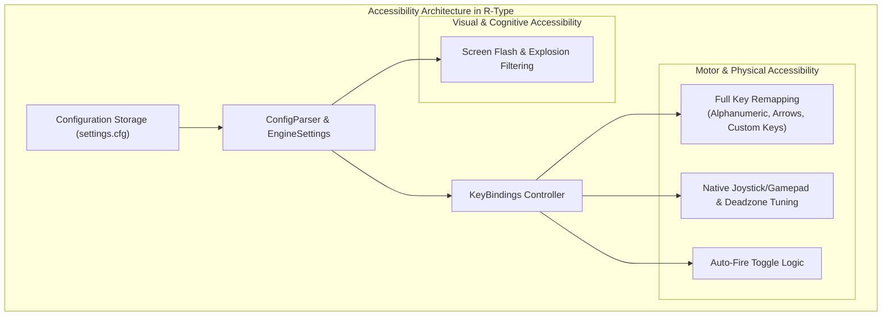
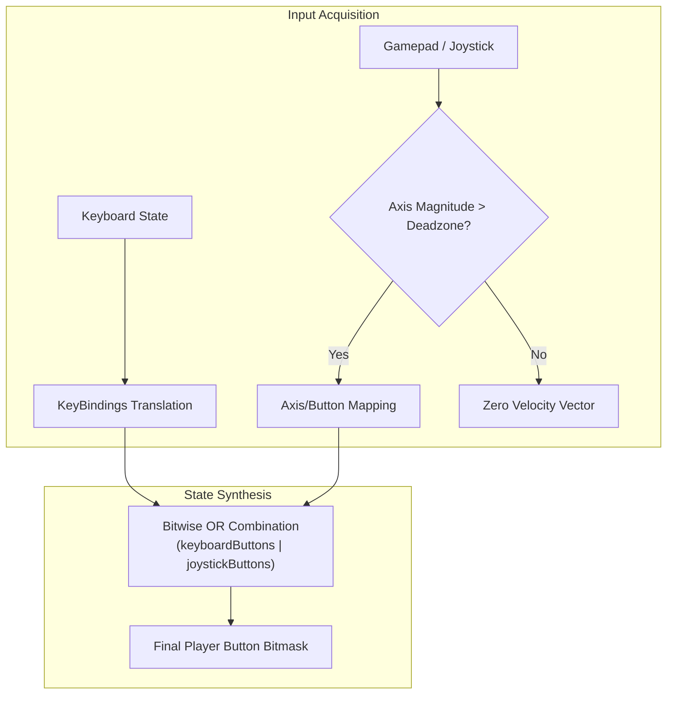
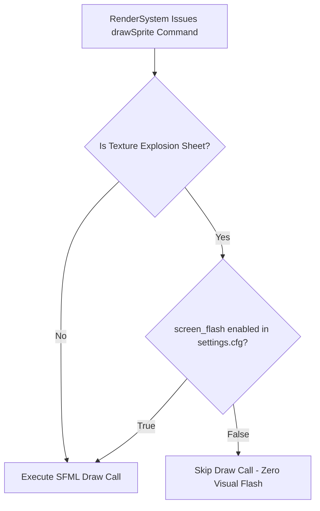

# Accessibility Technical Study

This technical study explores the accessibility design, architectural implementation, and comparative benefits of the accessibility features built into **R-Type**.

---

## 1. Executive Summary & Design Philosophy

Classic arcade shoot 'em ups from the late 1980s were notorious for uncompromising physical demands: rigid button configurations, relentless manual button mashing, and intense strobe/explosion visuals designed for cathode-ray tube (CRT) coin-op cabinets.

In modern video game engineering, accessibility is not an optional aesthetic choice; it is an essential architectural requirement. By adhering to international frameworks such as the **Game Accessibility Guidelines (GAG)** and the **Xbox Accessibility Guidelines (XAG)**, our implementation guarantees that barriers related to motor control, muscle fatigue, sensory processing, and photosensitivity are systematically addressed.



---

## 2. Motor and Physical Disabilities

Players with motor impairments often experience restricted fine motor control, reduced range of motion, muscle tremors, or chronic joint pain. Without accessibility affordances, traditional shoot 'em ups quickly become unplayable.

### 2.1 Feature: Full Key Remapping and Native Gamepad Support

#### Code Implementation Details

The input subsystem decouples hardware events from game actions:

- **Configurable Key Map** (`src/client/SFML/KeyBindings.cpp`):
  - Every gameplay action (`Up`, `Down`, `Left`, `Right`, `Fire`, `AutoFire`) can be mapped to any key in the `sf::Keyboard::Key` enum via `settings.cfg`.
  - The configuration parser supports natural key names (e.g., `Z`, `Q`, `S`, `D`, `Space`, `Enter`, `Escape`).
- **Native Gamepad / Joystick Integration** (`src/client/SFML/Sfml.cpp`):
  - Standardized analog axis sampling with configurable deadzone filtering.
  - Configurable button indices for firing (`0`) and auto-fire toggling (`1`).
- **Unified Hardware Polling** (`Sfml::buttons()`):
  - Synthesizes input by performing a bitwise OR:
    ```cpp
    buttons = keyboardButtons() | joystickButtons();
    ```
  - This allows concurrent input from multiple devices simultaneously without mode-switching conflicts.



#### Why It Is Crucial

1. **Adaptive Controller Compatibility:** Players with spinal cord injuries, muscular dystrophy, or cerebral palsy frequently rely on specialized hardware such as the **Xbox Adaptive Controller (XAC)**, QuadStick mouth-operated joysticks, or large-format arcade switches. Because our client polls standard USB joystick and keyboard inputs simultaneously, players can route movement to foot pedals and firing to an adaptive switch seamlessly.
2. **Elimination of Painful Hand Contortions:** Standard WASD or Arrow-key layouts assume standard hand size and finger dexterity. Full remapping allows one-handed layouts or custom cluster mappings that prevent painful hand positions.
3. **Deadzone Filtering Against Tremors and Stick Drift:** Tremors caused by Parkinson's or motor disorders can trigger unintentional directional inputs. A customizable deadzone threshold filters out micro-movements and prevents unwanted ship drift.

---

### 2.2 Feature: Toggleable Auto-Fire

#### Code Implementation Details

- **Input State Latch:**
  In `Sfml::keyboardButtons()` and `Sfml::joystickButtons()`, a dedicated action (`ActionType::AutoFire`) detects key and button presses.
- **Single-Press Toggle Logic:**
  ```cpp
  if (autoFirePressed && !_autoFireWasPressed) {
      _autoFireEnabled = !_autoFireEnabled;
  }
  ```
- **Continuous Packet Assertion:**
  Whenever `_autoFireEnabled` is active, the client automatically inserts `game::BUTTON_FIRE` into the emitted button bitmask on every 60 Hz frame tick.

#### Why It Is Crucial

1. **Repetitive Strain Injury (RSI) Prevention:** A standard session of a classic horizontal shoot 'em up requires hundreds of button presses per minute. This high-frequency repetition causes acute tendonitis, carpal tunnel flare-ups, and severe muscle strain.
2. **Motor Fatigue Barrier Removal:** For players suffering from chronic fatigue syndrome, rheumatoid arthritis, or neuromuscular disorders, sustained high-frequency tapping is physically impossible. Auto-fire levels the playing field, shifting the challenge from pure physical stamina to spatial awareness, tactical positioning, and pattern memorization.

---

## 3. Visual and Cognitive Disabilities

Horizontal space shooters feature high contrast, dense projectile patterns, and rapid velocity changes. Without careful visual controls, these elements can trigger medical emergencies or cognitive exhaustion.

### 3.1 Feature: Screen Flash and Explosion Suppression

#### Code Implementation Details

Visual configuration is managed through the engine settings subsystem:

- **Engine Configuration** (`src/game_engine/EngineSettings.cpp`):
  - Reads `screen_flash = true|false` from `settings.cfg`.
  - Exposes `EngineSettings::screenFlashEnabled() const`.
- **Render Interception in SFML Backend** (`src/client/SFML/Sfml.cpp`):
  Inside `Sfml::drawSprite()`, the renderer verifies the flash setting before rasterizing explosive spritesheets:
  ```cpp
  if (!_engineSettings.screenFlashEnabled() && command.texture == sprites::EXPLOSION_SHEET) {
      return;
  }
  ```
- When `screen_flash = false`, all full-screen blast frames and high-intensity strobe animations are bypassed in real-time without altering simulation physics or gameplay state on the server.



#### Why It Is Crucial

1. **Photosensitive Epilepsy (PSE) Protection:**
   - Approximately **3% of individuals with epilepsy** experience photosensitive seizures provoked by flashing lights or contrasting light-and-dark patterns (typically between 3 Hz and 30 Hz).
   - In retro shoot 'em ups, rapid explosion animations create high-frequency luminance flashes against a dark cosmic background. Disabling these explosions eliminates this hazardous seizure trigger, ensuring safety for photosensitive players.
2. **Sensory Overload & Cognitive Processing:**
   - Players with **Autism Spectrum Disorder (ASD)**, **Attention Deficit Hyperactivity Disorder (ADHD)**, or post-concussion syndrome frequently experience sensory overload when the screen is filled with sudden, intense visual noise.
   - Suppressing explosive flashes keeps the screen visually clean and readable, allowing players with cognitive processing difficulties to track enemy trajectories and incoming projectiles without overwhelming visual distraction.
3. **Migraine and Photophobia Prevention:**
   - Prolonged exposure to abrupt screen flashing is a primary trigger for chronic migraines and ocular fatigue. Disabling screen flashes enables longer, comfortable gaming sessions for photophobic individuals.

---

## 4. Comparative Analysis: Arcade Baseline vs Modern Standards

The table below contrasts the original 1987 arcade R-Type experience with modern accessibility benchmarks:

| Aspect | 1987 Arcade R-Type | Modern Industry Standards (GAG / XAG) | Our R-Type Implementation |
|---|---|---|---|
| **Control Layout** | Hardwired 8-way joystick and microswitch buttons. | **XAG 101:** All buttons and axes must be fully remappable. | Configurable via `settings.cfg` for all keyboard keys and gamepad buttons. |
| **Alternative Controllers** | Incompatible; proprietary cabinet wiring only. | **XAG 101:** Support standard OS input abstraction for adaptive hardware. | Unified keyboard and joystick input bitmasks; fully compatible with adaptive controllers. |
| **Analog Sensitivity** | N/A (Digital switches). | **GAG Motor:** Provide deadzone calibration for analog sticks. | Configurable `joystick_deadzone` (default 30) preventing drift and involuntary tremors. |
| **Firing Mechanism** | Mandatory continuous manual button mashing. | **GAG Motor:** Provide toggle or hold mechanisms for repetitive actions. | Dedicated auto-fire toggle switch (`auto_fire = X`, gamepad button 1). |
| **Flashing & Strobes** | Uncapped multi-frame bright white explosion flashes on CRT. | **XAG 104 / ITU-R BT.1702:** Eliminate or allow toggling of rapid visual flashes. | `screen_flash = false` setting intercepts and suppresses all explosion flash sprites. |
| **Visual Hierarchy** | Cluttered battlefield with explosion debris obscuring bullets. | **GAG Cognitive:** Provide options to reduce visual clutter and sensory noise. | Explosion suppression preserves background and projectile clarity. |

---

## 5. Architectural Quality and Extensibility

Our accessibility features are designed directly into the engine's core architecture rather than retrofitted as superficial hacks:

- **Zero Performance Overhead:** The `screenFlashEnabled()` check is an inline boolean guard executed before SFML sprite transform calculations, resulting in negligible CPU cycles.
- **Server Agnostic:** The authoritative server simulates projectile collisions and registers damage events regardless of client visual presentation. Disabling visual flashes does not affect game balance, network synchronization, or multiplayer fairness.
- **Stateless Persistence:** All accessibility preferences persist across sessions through the human-readable `settings.cfg` file, making them easily editable outside the game (e.g., via screen readers or system configuration scripts).
