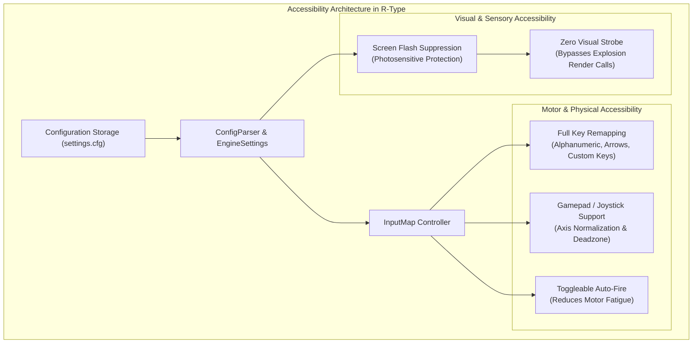
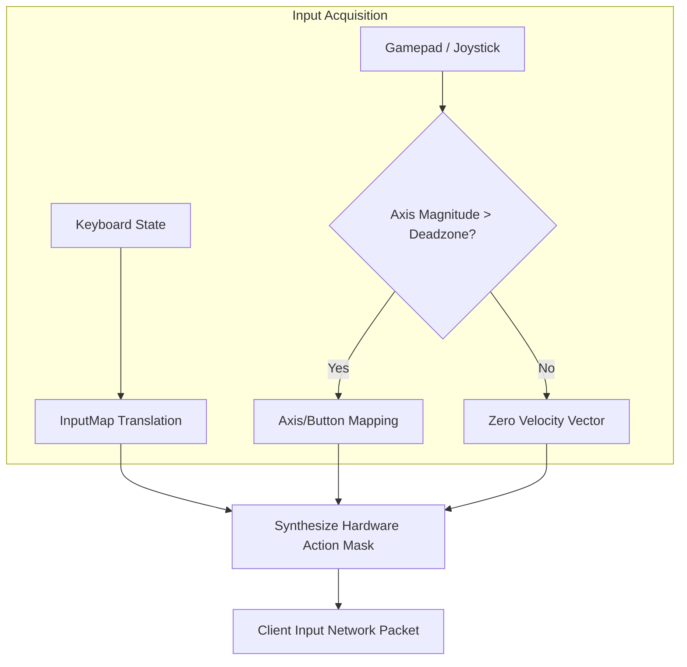
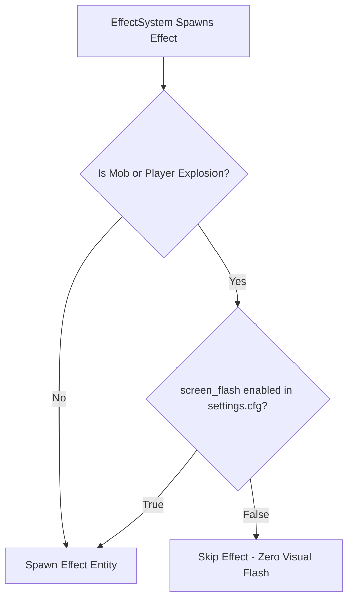

# R-Type Accessibility Study & Architecture
**Project:** R-Type  
**Focus:** Accessibility Features, Structural Justification & Architecture  

---

## 1. Executive Summary & Context

Video games are increasingly recognized not just as entertainment, but as cultural experiences that must be universally accessible. In fast-paced arcade shooters like **R-Type**, cognitive load, rapid visual changes, and precise reflex requirements create significant barriers for players with varying physical, sensory, and cognitive abilities.

To address these barriers, our engine and game architecture incorporate deliberate design choices targeting two primary accessibility domains:
1. **Motor & Physical Accessibility:** Custom input mapping supporting full keyboard rebindability and analog joystick/gamepad input with configurable deadzones.
2. **Visual & Sensory Accessibility:** A strict, non-intrusive screen flash toggle (`screen_flash`) designed to protect players with photosensitive epilepsy (PSE) or sensory processing sensitivities.



---

## 2. Motor Accessibility: Adaptive Input System

### 2.1 Problem Statement
Players with motor impairments often experience restricted fine motor control, reduced range of motion, muscle fatigue, or tremors. Standard hardcoded control schemes (such as fixed arrow keys or `WASD`) prevent individuals using specialized adaptive controllers, one-handed setups, or custom ergonomic layouts from playing.

### 2.2 Architectural Implementation
The input subsystem decouples hardware events from game actions:

- **Configurable Key Map** (`engine/input/src/InputMap.cpp`, actions declared in `games/rtype/src/client/app/ClientControls.cpp`):
  - Every gameplay action (`up`, `down`, `left`, `right`, `fire`, `auto_fire`, `quit`) can be mapped to any key name listed in `KEY_NAMES` (`engine/input/src/sfml/SfmlInput.cpp`) via `settings.cfg`.
  - The configuration parser supports natural key names (e.g., `Z`, `Q`, `S`, `D`, `Space`, `Enter`, `Escape`).
- **Native Gamepad / Joystick Integration** (`engine/input/src/sfml/SfmlInput.cpp`):
  - Standardized analog axis sampling with configurable deadzone filtering.
  - Configurable button indices for firing (`0`) and auto-fire toggling (`1`).
- **Unified Hardware Polling** (`SfmlInput::update()`):
  - An action is held when its key or its joystick button or axis is held:
    ```cpp
    state.down = (keyboardFocused && keyDown(action)) || joystickDown(action);
    ```
  - This allows concurrent input from multiple devices simultaneously without mode-switching conflicts.



### 2.3 Auto-Fire Support
Repetitive button pressing is one of the leading causes of repetitive strain injury (RSI) and presents an insurmountable barrier to players with muscular dystrophy, arthritis, or motor coordination difficulties.
- Our client implements an **Auto-Fire state machine**:
  - Activated or toggled via a mapped key/button.
  - Generates continuous, rhythmic fire packets at an optimal cadence without requiring continuous manual depression of a physical button.

---

## 3. Visual Accessibility: Photosensitivity & Screen Flash Suppression

### 3.1 Problem Statement
Horizontal space shooters feature high contrast, dense projectile patterns, and sudden, intense luminance shifts when targets explode. Flashing effects, screen strobes, and full-screen color inversions can trigger:
- **Photosensitive Epileptic Seizures (PSE)**
- **Photophobia and Migraines**
- **Sensory Overload** in neurodivergent players

### 3.2 Technical Mitigation
Visual configuration is managed through the engine settings subsystem:

- **Engine Configuration** (`engine/core/src/EngineSettings.cpp`):
  - Reads `screen_flash = true|false` from `settings.cfg`.
  - Exposes `EngineSettings::screenFlashEnabled() const`.
- **Effect Filtering in the Game** (`games/rtype/src/client/view/EffectSystem.cpp`):
  Inside `EffectSystem::add()`, the client skips explosion effects before they become sprites. The engine renderer knows nothing about this rule:
  ```cpp
  if (!_screenFlash && (kind == EffectKind::MobExplosion || kind == EffectKind::PlayerExplosion)) {
      return;
  }
  ```
- When `screen_flash = false`, all full-screen blast frames and high-intensity strobe animations are bypassed in real-time without altering simulation physics or gameplay state on the server.



#### Why It Is Crucial

1. **Photosensitive Epilepsy (PSE) Protection:**
   - Approximately **3% of individuals with epilepsy** experience photosensitive seizures provoked by flashing lights or contrasting light-and-dark patterns (typically between 3 Hz and 30 Hz).
   - In retro shoot 'em ups, rapid explosion animations create high-frequency luminance flashes against a dark cosmic background. Disabling these explosions eliminates this hazardous seizure trigger, ensuring safety for photosensitive players.

2. **Mitigating Sensory Overload:**
   - Autistic players and individuals with sensory processing sensitivities often experience intense cognitive fatigue or distress from sudden, repetitive flashes. Providing an option to suppress strobe effects maintains immersion while preventing overstimulation.

3. **Competitive Integrity Without Visual Noise:**
   - High-luminance particle and explosion sheets frequently obscure enemy projectiles and hitboxes. Allowing players to disable these flashes ensures that players with low contrast vision or visual tracking difficulties can follow gameplay elements clearly without compromising the server-side game state.

---

## 4. Configuration Protocol (`settings.cfg`)

Settings are saved in `settings.cfg`:

```ini
# Input Bindings
up=Z
down=S
left=Q
right=D
fire=Space
auto_fire=A

# Visual Accessibility
screen_flash=false
```

If the file is absent or incomplete upon initialization, `ConfigParser` populates it with accessible defaults, ensuring the client remains immediately playable across various system configurations.
