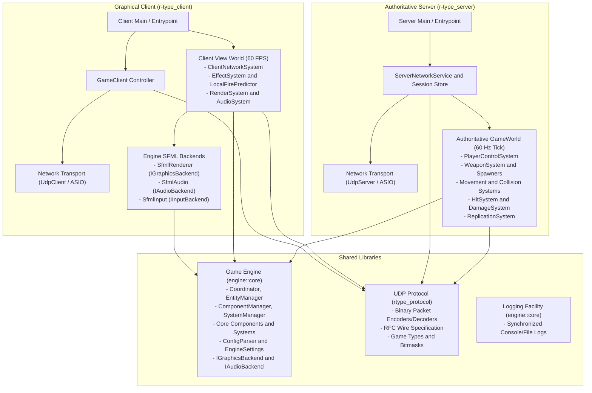
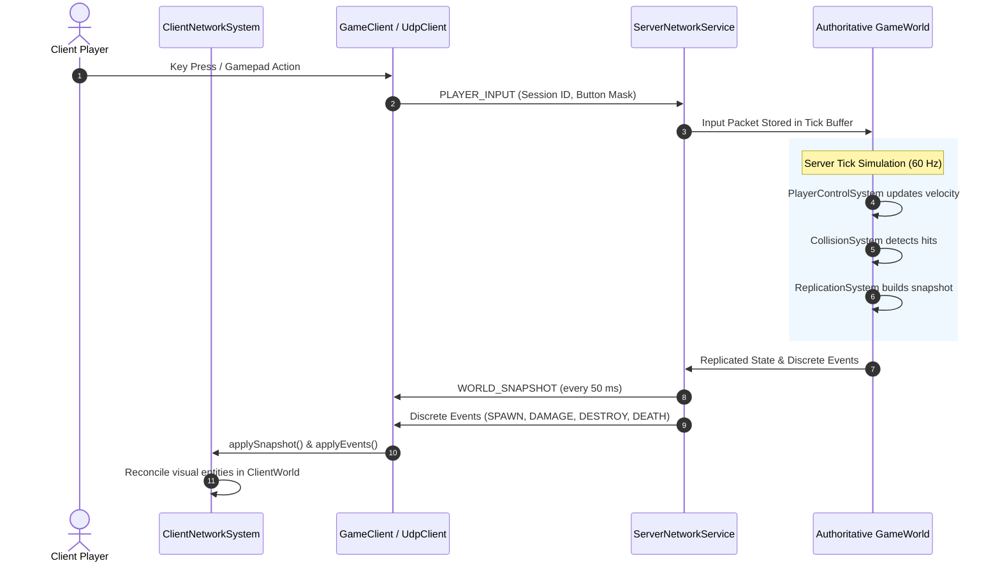
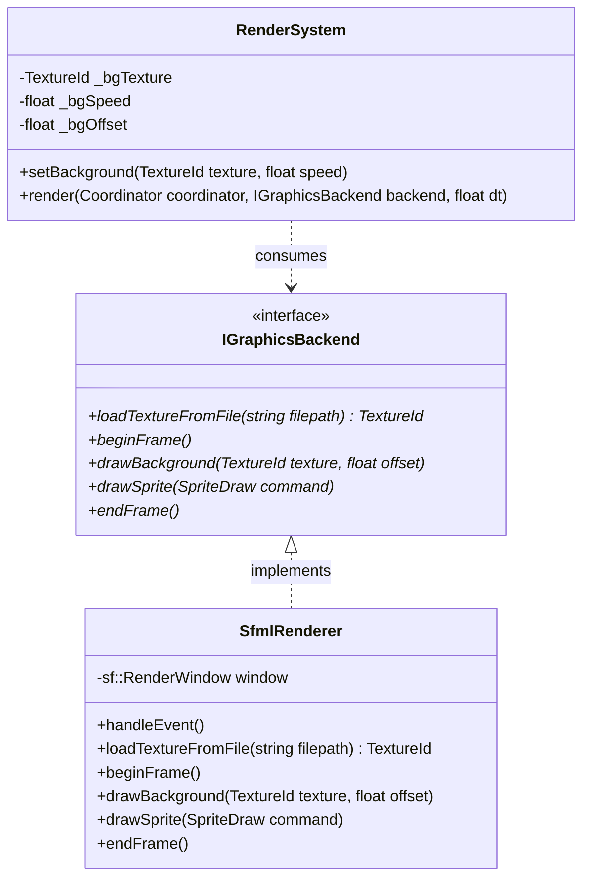
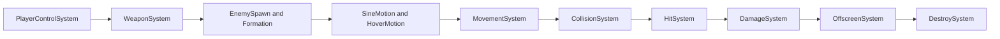

# Architecture & Systems Overview

This document presents the technical architecture of the **R-Type** game engine, client, and server, detailing how the subsystems are organized and how core mechanics (Network, Rendering, and Physics/Movement) materialize in the codebase.

---

## 1. High-Level Subsystem Architecture

The project is structured into modular layers adhering to separation of concerns and data-oriented design:

1. **Shared Engine Core (`engine::core`):** A custom Entity Component System (ECS) framework, configuration management, and hardware-agnostic backend interfaces.
2. **Shared Protocol & Types (`rtype_protocol` / `game`):** Network binary serialization routines, packet headers, constants, and button masks.
3. **Dedicated Server (`r-type_server`):** An authoritative headless server hosting the authoritative physics and gameplay simulation.
4. **Graphical Client (`r-type_client`):** An SFML graphical front-end consuming replicated server snapshots and running local presentation and prediction systems.

### Subsystem Dependency Diagram



---

## 2. Core Systems Overview

### 2.1 Network System

The networking layer is built on non-blocking UDP sockets using **Boost.Asio** (standalone Asio), designed around an authoritative server model.



#### Materialization in Code

- **Protocol Definition:** Encodes and decodes 16-byte common headers and payload structures defined in `RFC.md` (`games/rtype/src/utils/network/Protocol.hpp`).
- **Server Network Transport:** Manages asynchronous UDP socket listening and validates client nonces to assign unique 32-bit session IDs (`games/rtype/src/server/network/UdpServer.cpp` and `games/rtype/src/server/network/ServerNetworkService.cpp`).
- **Client Network Transport:** Sends initial `JOIN_REQUEST` packets and transmits sampled `PLAYER_INPUT` packets at 60 Hz (`games/rtype/src/client/network/UdpClient.cpp` and `games/rtype/src/client/network/GameClient.cpp`).
- **Client Network Synchronization:** Reconciles server entity IDs with client visual entities upon receiving `WORLD_SNAPSHOT` or discrete events (`games/rtype/src/client/view/ClientNetworkSystem.cpp`).
- **Client-Side Prediction:** Spawns local muzzle flashes and firing sound effects immediately on button press without waiting for network round-trips (`games/rtype/src/client/view/LocalFirePredictor.cpp`).

---

### 2.2 Rendering System

The rendering pipeline is split into an abstract engine interface and a hardware-accelerated SFML implementation.



#### Materialization in Code

- **Graphics Backend Interface:** Defines `IGraphicsBackend`, decoupling the engine from graphics libraries (`engine/render/include/engine/render/GraphicsBackend.hpp`).
- **Engine Render System:** Processes entities with `Position` and `Sprite`, updates animations, sorts by layer, and updates background offsets (`engine/render/src/RenderSystem.cpp`).
- **SFML Backend Implementation:** Concrete `IGraphicsBackend` using SFML windowing and sprites with texture caching (`engine/render/src/sfml/SfmlRenderer.cpp`).

---

### 2.3 Physics and Movement System

The game runs a deterministic 2D physics and collision detection pipeline on the server world at 60 ticks per second.



#### Materialization in Code

1. `PlayerControlSystem` (`games/rtype/src/server/ecs/Systems/PlayerControlSystem.cpp`): Translates active player button masks (`Up`, `Down`, `Left`, `Right`) into directional velocities on the entity's `Velocity` component.
2. **Weapons & Spawners** (`games/rtype/src/server/ecs/Systems/WeaponSystem.cpp` and `games/rtype/src/server/game/Prefabs.cpp`): Checks firing cooldowns and instantiates projectile entities with appropriate velocities and bounding boxes.
3. **Algorithmic Trajectories:**
   - `SineMotionSystem.cpp`: Applies vertical sinusoidal movement:
     ```
     y(t) = y0 + A * sin(omega * t)
     ```
     to specific enemy archetypes.
   - `HoverMotionSystem.cpp`: Applies smooth hovering and drifting behavior.
4. **Linear Motion Integration** (`engine/core/src/systems/MovementSystem.cpp`):
   - Signature: `ecs::Position` and `ecs::Velocity`.
   - Formula: Position increments by Velocity multiplied by delta time.
5. **Collision Detection** (`engine/physics/src/CollisionSystem.cpp`):
   - Signature: `ecs::Position` and `ecs::Collider`.
   - Executes 2D Axis-Aligned Bounding Box (AABB) intersection tests and emits a list of `CollisionPair` structs.
6. **Hit Resolution** (`games/rtype/src/server/ecs/Systems/HitSystem.cpp`):
   - Compares the tag and mask bitfields of colliding entities to filter valid combat interactions.
7. **Damage Calculation** (`games/rtype/src/server/ecs/Systems/DamageSystem.cpp`):
   - Subtracts the attacker's `Damage` from the victim's `Health`, attaching `Destroy` if health reaches zero.
8. **Boundary Checking** (`games/rtype/src/server/ecs/Systems/OffscreenSystem.cpp`):
   - Flags entities traveling beyond field boundaries plus `OFFSCREEN_MARGIN` with `Destroy`.
9. **Entity Clean-Up** (`engine/core/src/systems/DestroySystem.cpp`):
   - Iterates through all entities tagged with `Destroy` and invokes `Coordinator::destroyEntity()` to recycle IDs and unregister components in O(1) time.
