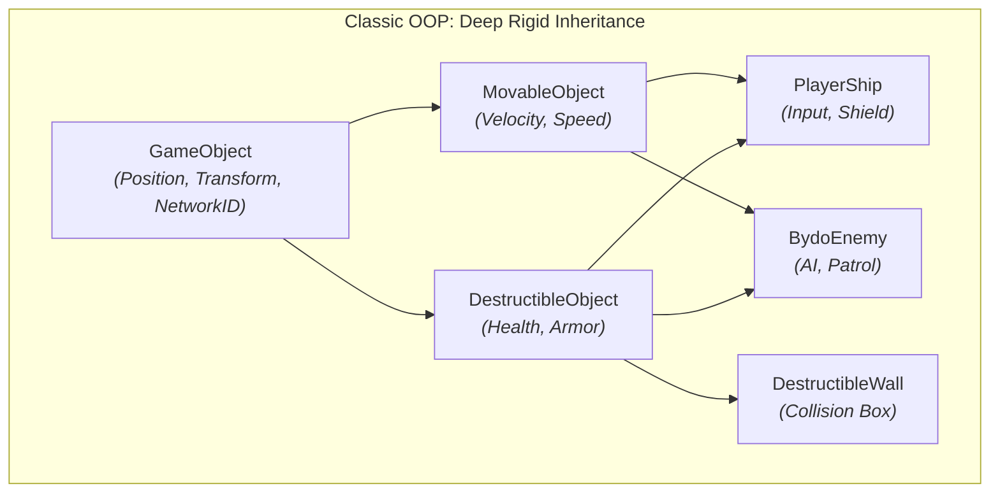
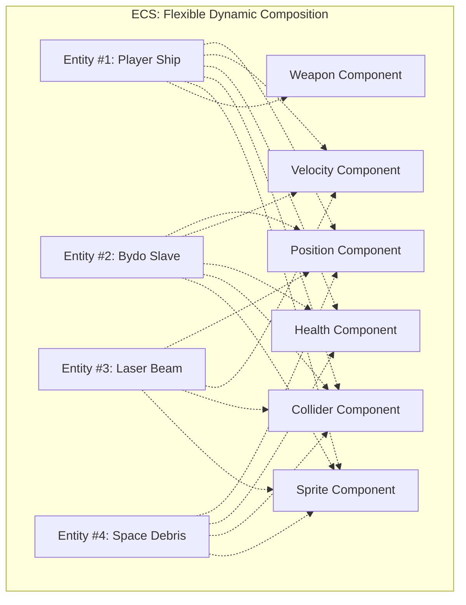
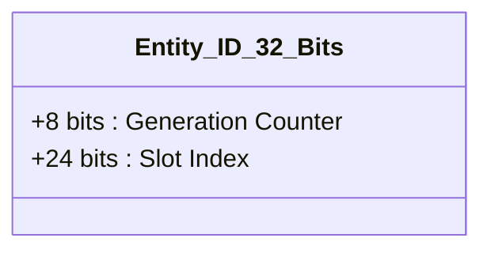
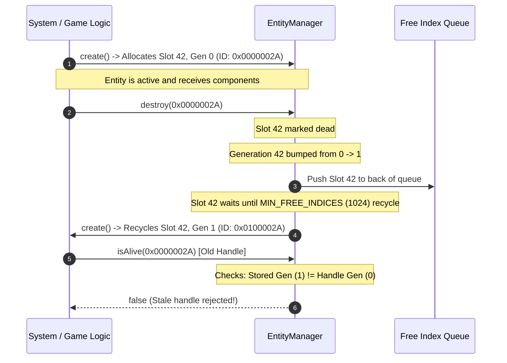
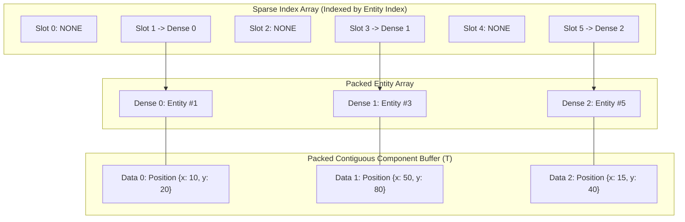
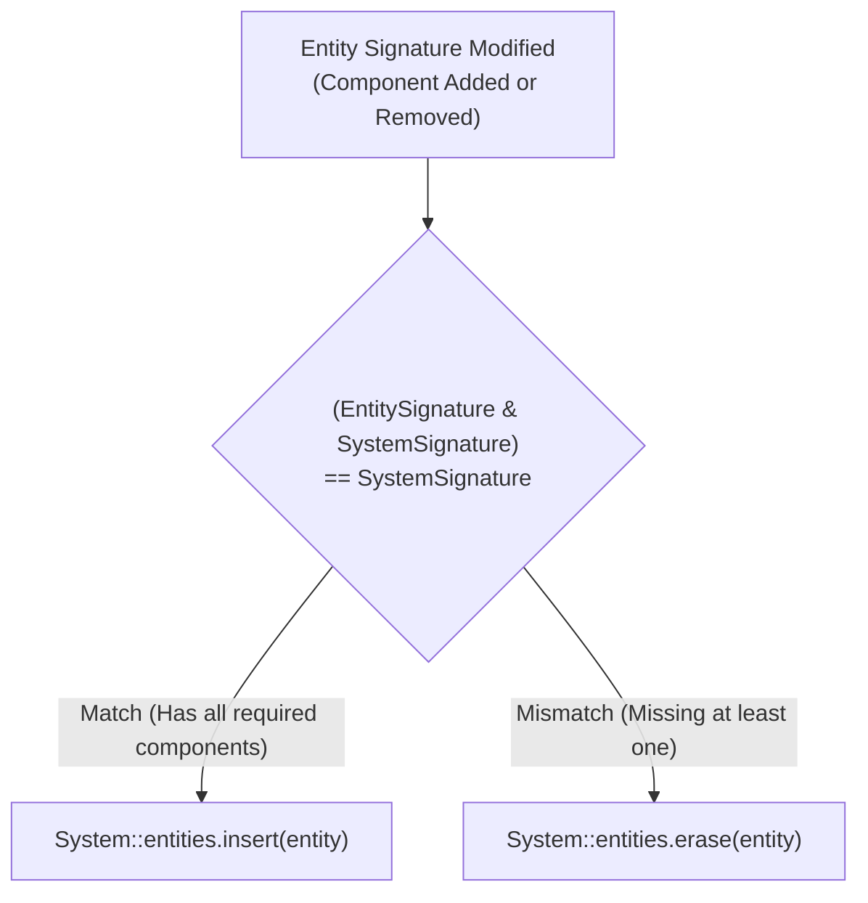
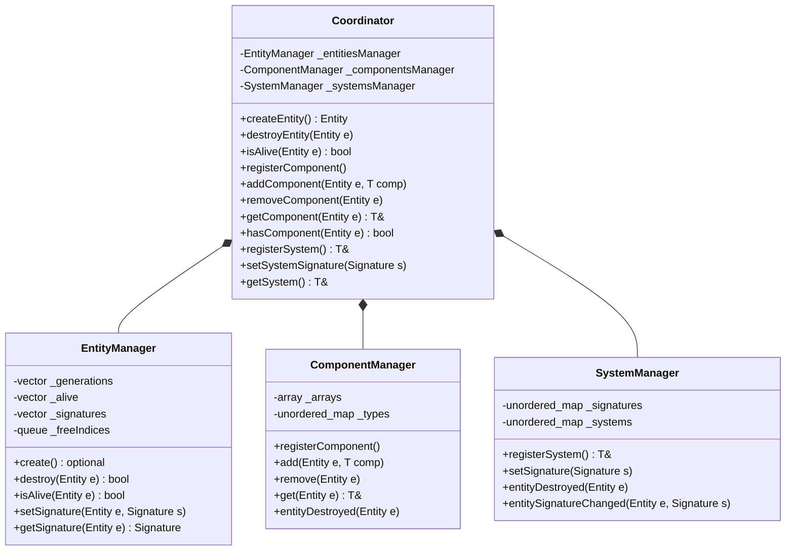
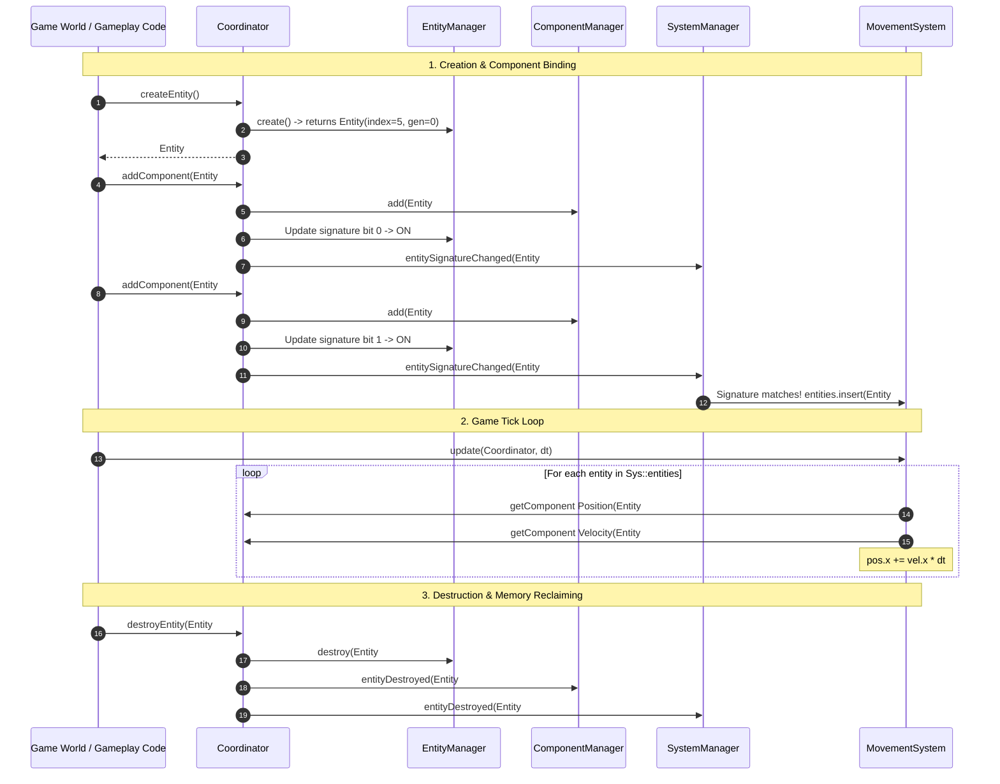

# Entity Component System (ECS) Guide

This guide details the architectural philosophy, data structures, and operational mechanics of the custom **Entity Component System (ECS)** built for the R-Type engine.

---

## 1. Paradigm Shift: ECS vs Classic OOP

### The Inheritance Trap in Object-Oriented Game Engines

In classic Object-Oriented Programming (OOP), game entities are organized into deep class inheritance hierarchies. While intuitive for small projects, this model quickly leads to architectural bottlenecks:

- **The Diamond Problem:** If an entity needs traits from multiple branches (e.g., a flying destructible enemy ship that is also an interactive obstacle), multiple inheritance causes ambiguous dispatch and bloated interfaces.
- **Tight Coupling:** Data and behavior are fused together into monolithic base classes (`GameObject`, `Actor`, `Pawn`).
- **Cache Inefficiency:** In OOP, entities are allocated on the heap as scattered objects connected by pointers (`std::vector` of heap pointers). Iterating over hundreds of objects triggers frequent CPU cache misses due to pointer chasing.



### The ECS Composition Model

The Entity Component System embraces **Data-Oriented Design (DOD)** by strictly decoupling identity, data, and behavior:

- **Entities:** Pure numeric handles (IDs) without fields or methods.
- **Components:** Plain Old Data (POD) structs with no logic.
- **Systems:** Stateless algorithms that process batches of matching components.



---

## 2. Core Concepts in Our Engine

### 2.1 Entities: Generational ID Packing

In our engine, an `Entity` is not a heap-allocated object, but a lightweight 32-bit unsigned integer (`std::uint32_t`).



- **Slot Index (24 bits):** Identifies the entity's row in component arrays. Supports up to 16,777,215 simultaneous slots (2^24 - 1).
- **Generation Counter (8 bits):** Tracks how many times a given slot index has been recycled (0 to 255).
- **Null Entity (`0xFFFFFFFF`):** A sentinel value denoting an invalid or unassigned entity.

#### Stale Handle Prevention & Slot Recycling

A common pitfall in game development is the **dangling entity reference** (e.g., a homing missile tracking an enemy entity that was destroyed in the previous frame).

Our `EntityManager` prevents stale handle bugs through generational validation:



The lifecycle rules for entities are:

- **Destruction**: When an entity is destroyed, its slot's generation counter is incremented modulo 256, its signature bitmask is wiped, and the index is pushed into `_freeIndices`.
- **Delayed Recycling**: A freed slot index is not reused immediately. It remains queued until more than `MIN_FREE_INDICES` (1024) entities have been recycled (or when maximum capacity is reached). This ensures a long buffer period before an index reappears.
- **Liveness Validation**: `isAlive(Entity)` checks that index is in bounds, alive flag is true, and stored generation matches the entity's generation.

---

### 2.2 Components: Contiguous Sparse Sets

Components are pure data structures (e.g., `Position`, `Velocity`, `Health`, `Collider`, `Sprite`).

To achieve O(1) lookups, O(1) additions, O(1) removals, and linear memory traversal for CPU cache locality, our `ComponentArray` template implements a **Sparse Set** pattern:



- **Sparse Vector (`_sparse`):** Indexed directly by `Entity::index()`. Maps an entity's slot to its location in the packed dense arrays, or `NONE` if the component is absent.
- **Dense Vector (`_dense`):** Tightly packed list of active `Entity` handles.
- **Data Vector (`_data`):** Tightly packed contiguous buffer of component data `T`. Iterating over components is a direct contiguous memory loop with zero pointer indirection.
- **Swap-and-Pop Removal:** When an entity is removed, the last component in `_data` and its corresponding entity in `_dense` are swapped into the vacated index, updating the moved entity's sparse pointer in O(1) time without shifting elements.

#### Component Signatures

Every entity has a component bitmask:
```cpp
using Signature = std::bitset<64>; // MAX_COMPONENTS = 64
```
When a component `T` is added or removed, its unique bit (assigned by `ComponentManager::getType<T>()`) is toggled.

---

### 2.3 Systems: Signature Filtering

Systems encapsulate gameplay logic. They do not hold entity data; instead, each system defines a required component signature:
```cpp
System Signature = Bitmask of Required Component Types
```



- **Automated Membership:** Whenever `Coordinator::addComponent` or `Coordinator::removeComponent` is called, `SystemManager::entitySignatureChanged` tests the entity's signature against all registered system signatures via a fast bitwise AND:
  ```cpp
  (entitySignature & systemSignature) == systemSignature
  ```
- **Filtered Entity Set:** Matching entities are stored in each system's `std::set<Entity> entities`.
- **System Execution:** During updates, systems iterate strictly over their filtered entity set, querying the `ComponentManager` for the exact data required.

---

## 3. Engine Architecture & Execution Flow

The `Coordinator` acts as the unifying facade that controls the three managers: `EntityManager`, `ComponentManager`, and `SystemManager`.



### Complete Entity Lifecycle Walkthrough


