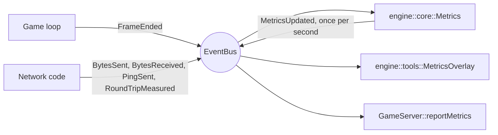

# Metrics

The engine measures frame timing, bandwidth, latency and packet loss. The
client shows them in an overlay toggled with **F3** (the `metrics` action in
`settings.cfg`); the server writes them to its log.

---

## 1. What Each Value Means

```text
FPS     60.0   frame 16.7 ms (worst 18.2)
Work    2.10 ms (worst 4.05)
Ping    19 ms   avg 18   jitter 0.7
Loss    0.0 %
Up      5.23 KiB/s   33 pkt/s
Down    0.55 KiB/s   24 pkt/s
```

| Line | Meaning | Event |
| --- | --- | --- |
| `FPS` | Frames per second, and the average and worst real time between two frames | `FrameEnded::seconds` |
| `Work` | Time spent working in a frame (update, drawing, audio), before `endFrame()` waits for the frame rate limit | `FrameEnded::busySeconds` |
| `Ping` | Last round-trip time, its smoothed average, and the jitter (smoothed difference between two samples) | `RoundTripMeasured` |
| `Loss` | Share of `PING` probes left unanswered over the last five periods | `PingSent`, `RoundTripMeasured` |
| `Up` / `Down` | Bandwidth and packets per second, protocol header included, UDP/IP headers excluded | `BytesSent`, `BytesReceived` |

Values refresh once per second (`Metrics::PERIOD_SECONDS`). `--` means there is
nothing to measure yet: latency and loss appear once the client is connected.

- 60 FPS with 2 ms of work leaves plenty of headroom; 60 FPS with 15 ms leaves
  almost none.
- A ping around 17 ms on localhost is normal: the server reads datagrams once
  per tick.
- Latency uses `PING`/`PONG` (see [UDP protocol](../../RFC.md)), one probe every
  250 ms, smoothed with the TCP factors of RFC 6298.

The server logs one line every ten periods while it receives datagrams. The
budget is the tick duration: a worst tick work time close to it means the
server is about to fall behind.

```text
[INFO] Metrics: 60.0 ticks/s, tick work avg 0.14 ms / worst 0.30 ms (budget 16.67 ms), up 5.16 KiB/s (34 pkt/s), down 0.43 KiB/s (24 pkt/s)
```

---

## 2. How It Works

Producers and consumers only share the `EventBus`:



`Metrics` lives in `engine::core` so the server, which does not link
`engine::render`, can use it. It reads no clock: time only advances through
`FrameEnded`.

---

## 3. Using It in Another Game

The engine does not own the game loop, so each game wires the key and the
drawing itself. R-Type does it in `ClientControls.cpp` and `ClientApp.cpp`.

**Step 1: link the modules** (`ENGINE_BUILD_TOOLS` from the repository root,
the `tools` component from an installed engine).

```cmake
target_link_libraries(my_game PRIVATE engine::core engine::render engine::input engine::tools)
```

**Step 2: ship a font** under the asset root. Without one, the overlay only
draws its background.

```cpp
engine::render::SfmlRenderer window({.title = "My Game", .fontFile = "fonts/LiberationMono-Regular.ttf"});
```

**Step 3: create the bus first**, then the collector and the overlay, which
subscribe to it and must be destroyed before it.

```cpp
engine::core::EventBus bus;
engine::core::Metrics metrics(bus);
engine::tools::MetricsOverlay overlay(bus);
```

**Step 4: bind a key.**

```cpp
engine::input::InputMap map;
map.bindKey("metrics", "F3");
engine::input::SfmlInput input(std::move(map));
```

**Step 5: the frame loop.** Draw the overlay after the scene, measure the work
time before `endFrame()`, then publish the frame.

```cpp
using Clock = std::chrono::steady_clock;
auto lastFrame = Clock::now();

while (window.isOpen()) {
	const auto frameStart = Clock::now();
	window.handleEvent();
	input.update(window.hasFocus());
	if (input.justPressed("metrics")) {
		overlay.toggle();
	}
	const float frameSeconds = std::chrono::duration<float>(frameStart - lastFrame).count();
	lastFrame = frameStart;

	// ... update the game ...

	window.beginFrame();
	// ... draw the game ...
	overlay.draw(window);
	const float workSeconds = std::chrono::duration<float>(Clock::now() - frameStart).count();
	window.endFrame();
	bus.publish(engine::core::FrameEnded{.seconds = frameSeconds, .busySeconds = workSeconds});
}
```

**Step 6 (optional): network metrics.** Publish one event per datagram:

```cpp
transport.send(bytes);
bus.publish(engine::core::BytesSent{bytes.size()});

for (const auto& bytes : transport.receivePending()) {
	bus.publish(engine::core::BytesReceived{bytes.size()});
}
```

Latency and loss need a request the other side answers, like R-Type's
`PING`/`PONG`: publish `PingSent` when a probe leaves and `RoundTripMeasured`
when its answer arrives.

---

## 4. Testing Under Bad Network Conditions

On Linux, `tc netem` degrades the loopback interface:

```sh
sudo tc qdisc add dev lo root netem delay 50ms loss 5%
sudo tc qdisc del dev lo root
```

It applies to both directions: `delay 50ms` shows a ping around 100 ms, and
5 % loss each way loses about 10 % of the round trips.
