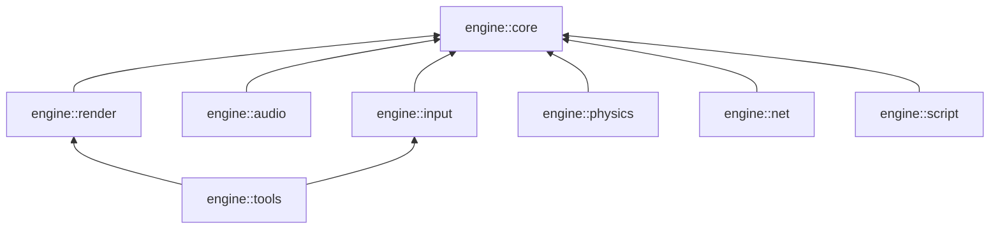

# Engine Modules

The engine is split into independent modules. A game only compiles and links the modules it needs, so a binary carries no code and no third-party library it does not use.

Modularity works at two levels:

- **Compile time:** each module is enabled or disabled with a CMake option. A disabled module is never compiled, and vcpkg never downloads its dependencies.
- **Link time:** each module is a separate library (`engine::core`, `engine::net`, ...). A game links only the ones it uses.

---

## 1. Module List

| Module            | Option                 | Default | Depends on            | Third-party            | vcpkg feature | Content                                   |
| ----------------- | ---------------------- | ------- | --------------------- | ---------------------- | ------------- | ----------------------------------------- |
| `engine::core`    | always built           | ON      | none                  | none                   | none          | ECS, config, logger, errors, movement, interpolation, timed queue, `EventBus`, `Metrics` |
| `engine::render`  | `ENGINE_BUILD_RENDER`  | ON      | core                  | SFML Graphics          | `render`      | Graphics backend, `SfmlRenderer` (window, textures, text), `Sprite`, `RenderSystem` |
| `engine::audio`   | `ENGINE_BUILD_AUDIO`   | ON      | core                  | SFML Audio             | `audio`       | Audio backend, `SfmlAudio`, `Sound`, `AudioSystem` |
| `engine::input`   | `ENGINE_BUILD_INPUT`   | ON      | core                  | SFML Window            | `input`       | `InputMap` (actions), `SfmlInput` (keyboard, joystick) |
| `engine::physics` | `ENGINE_BUILD_PHYSICS` | ON      | core                  | none                   | none          | `Collider`, `CollisionSystem`             |
| `engine::net`     | `ENGINE_BUILD_NET`     | ON      | core                  | asio                   | `net`         | Transport interfaces, UDP, packets        |
| `engine::script`  | `ENGINE_BUILD_SCRIPT`  | OFF     | core                  | Lua, sol2              | `script`      | Lua bindings (not implemented yet)        |
| `engine::tools`   | `ENGINE_BUILD_TOOLS`   | OFF     | core, render, input   | (from render, input)   | `tools`       | `MetricsOverlay` (see [Metrics](engine/tools/metrics.md)); console and editor not implemented yet |

`script` has no sources yet: configure stops with an error if `ENGINE_BUILD_SCRIPT` is ON. The R-Type root build turns `ENGINE_BUILD_TOOLS` on together with the client.

Input does not depend on render. `SfmlInput` reads the keyboard and joysticks directly; the game passes it the window focus each frame:

```cpp
window.handleEvent();                             // engine::render
input.update(window.hasFocus());                  // engine::input
if (input.isDown("fire")) { ... }
```

SFML backends hide SFML behind a private implementation, so a game includes `engine/render/SfmlRenderer.hpp` without seeing any SFML header and does not link SFML itself.



---

## 2. Folder Layout

Each module has its own folder with its own headers, sources and `CMakeLists.txt`:

```
engine/
├── CMakeLists.txt          # options, dependencies, module loop, install
├── vcpkg.json              # one feature per module
├── cmake/
│   └── EngineConfig.cmake.in
├── core/
│   ├── CMakeLists.txt
│   ├── include/engine/core/...
│   └── src/...
├── render/
│   ├── CMakeLists.txt
│   ├── include/engine/render/...
│   └── src/...
└── audio/ input/ physics/ net/ script/ tools/   # same structure
```

A module's `include/` folder is only added to that module's target. Code that links `engine::core` alone cannot include `engine/render/...`: the header is not found at compile time. This keeps modules decoupled, since a missing link is reported as a compile error instead of a link error or a hidden dependency.

Components belong to the module that uses them:

| Header                          | Components                      | Namespace         |
| ------------------------------- | ------------------------------- | ----------------- |
| `engine/core/ecs/Components.hpp`    | `Position`, `Velocity`, `Destroy` | `engine::core`    |
| `engine/render/Components.hpp`  | `Sprite`, `Animation`           | `engine::render`  |
| `engine/audio/Components.hpp`   | `Sound`                         | `engine::audio`   |
| `engine/physics/Components.hpp` | `Collider`                      | `engine::physics` |

---

## 3. Choosing Modules

Options are passed with `-D` when running `cmake` (configure time). Their values are stored in `CMakeCache.txt`, so later runs keep them until changed.

### Engine alone

Every `ENGINE_BUILD_*` option can be set:

```bash
cmake -S engine -B build-engine -G Ninja \
  -DCMAKE_TOOLCHAIN_FILE=vcpkg/scripts/buildsystems/vcpkg.cmake \
  -DENGINE_BUILD_AUDIO=OFF
cmake --build build-engine
cmake --install build-engine --prefix install
```

The enabled modules are listed during configure:

```
-- Engine modules: core;render;input;physics;net
```

The install step only copies the libraries and headers of enabled modules. With only `core` enabled, `install/` contains `libengine_core.a` and `include/engine/core/`, nothing else.

### From the repository root (R-Type)

The root picks engine modules from the game targets:

| Option               | Default | Effect                                                    |
| -------------------- | ------- | --------------------------------------------------------- |
| `RTYPE_BUILD_SERVER` | ON      | Builds `r-type_server`, enables `physics` and `net`       |
| `RTYPE_BUILD_CLIENT` | ON      | Builds `r-type_client`, enables `render`, `audio`, `input`, `net` |

Server-only build:

```bash
cmake -S . -B build-server -G Ninja \
  -DCMAKE_TOOLCHAIN_FILE=vcpkg/scripts/buildsystems/vcpkg.cmake \
  -DRTYPE_BUILD_CLIENT=OFF
cmake --build build-server
```

Configure prints `-- Engine modules: core;physics;net`, and vcpkg installs only `asio`: SFML is never downloaded, compiled or linked.

---

## 4. vcpkg Features

`engine/vcpkg.json` declares one feature per module that has a third-party dependency. CMake maps the enabled options to `VCPKG_MANIFEST_FEATURES` before `project()`, so vcpkg only installs what the build uses.

```json
"features": {
  "render": { "dependencies": [{ "name": "sfml", "features": ["graphics"] }] },
  "net":    { "dependencies": ["asio"] },
  "tools":  { "dependencies": [{ "name": "engine", "features": ["render", "input"] }] }
}
```

When building from the root, vcpkg reads the root `vcpkg.json` instead, which groups the same dependencies by game target (`server`, `client`, `script`, `tools`).

---

## 5. Using Modules in a Game

Inside the same CMake tree:

```cmake
add_subdirectory(engine)
target_link_libraries(my_server PRIVATE engine::core engine::physics engine::net)
target_link_libraries(my_client PRIVATE engine::core engine::render engine::audio engine::input)
```

From an installed engine, request the modules as components. `find_package` fails if one was not built:

```cmake
find_package(Engine 0.1 CONFIG REQUIRED COMPONENTS core physics net)
target_link_libraries(my_server PRIVATE engine::core engine::physics engine::net)
```

---

## 6. Adding a Module

1. Create `engine/<name>/` with `include/engine/<name>/`, `src/` and a `CMakeLists.txt`:

   ```cmake
   add_library(engine_<name>
       src/File.cpp
   )
   add_library(engine::<name> ALIAS engine_<name>)

   target_include_directories(engine_<name> PUBLIC
       $<BUILD_INTERFACE:${CMAKE_CURRENT_SOURCE_DIR}/include>
       $<INSTALL_INTERFACE:${CMAKE_INSTALL_INCLUDEDIR}>
   )

   target_link_libraries(engine_<name>
       PUBLIC engine::core
   )
   ```

2. In `engine/CMakeLists.txt`, add `option(ENGINE_BUILD_<NAME> ...)` and add `<name>` to the module `foreach`. Warnings, C++ standard, export name and install rules are applied automatically to every enabled module.
3. If the module needs a third-party library: add its `find_package` under `if(ENGINE_BUILD_<NAME>)`, a feature in `engine/vcpkg.json` and the root `vcpkg.json`, and a `find_dependency` in `cmake/EngineConfig.cmake.in`.

Use `PUBLIC` for a dependency that appears in the module's public headers, and `PRIVATE` for one only used in its `.cpp` files.

---

## 7. Verifying Independence

| Check                         | Command                                                                                     | Expected                                  |
| ----------------------------- | ------------------------------------------------------------------------------------------- | ----------------------------------------- |
| Engine builds with core only  | `cmake -S engine -B b -DENGINE_BUILD_RENDER=OFF -DENGINE_BUILD_AUDIO=OFF -DENGINE_BUILD_INPUT=OFF -DENGINE_BUILD_PHYSICS=OFF -DENGINE_BUILD_NET=OFF` | `-- Engine modules: core`                 |
| Server pulls no SFML          | `cmake -S . -B b -DRTYPE_BUILD_CLIENT=OFF`                                                  | vcpkg installs only `asio`                |
| Server links no SFML          | `ninja -C b -t commands r-type_server \| grep -i sfml`                                       | no output                                 |
| Core headers are self-contained | `grep -r "render\|audio\|physics\|net" engine/core/include`                                | no include of another module              |

SFML is linked statically by vcpkg, so `ldd` does not show it. Check the link command (`ninja -t commands`) instead.
