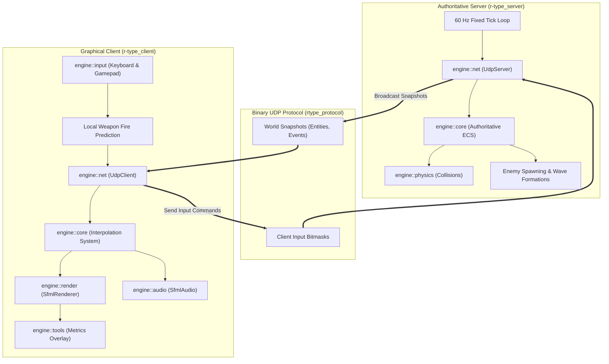

# R-Type Game Architecture

## Overview

**R-Type** is an online multiplayer 2D side-scrolling shoot'em up game inspired by the 1987 arcade classic. Developed in modern **C++20**, the game is built upon a modular custom game engine utilizing an Entity Component System (ECS) architecture, an authoritative headless UDP server, and a graphical client with client-side prediction.

Up to 4 players can connect cooperatively over a local network or the Internet to battle waves of enemies and bosses across space sectors.

---

## Client / Server Architecture Split

The game architecture strictly separates the authoritative world simulation from presentation and user input.

### 1. Authoritative Headless Server (`r-type_server`)

The server is the single source of truth for all game rules and entity states:
- **Fixed 60 Hz Tick Simulation:** Runs a deterministic simulation loop driven by `std::chrono::steady_clock`.
- **Authoritative Game Systems:**
  - `PlayerControlSystem`: Validates and applies client movement inputs and firing requests.
  - `EnemySpawnSystem` & `FormationSystem`: Drives waves of classic enemy formations (sine wave motions, hover patterns, dive bombers).
  - `CollisionSystem` (`engine::physics`): Computes AABB bounding-box intersections between projectiles, players, and enemies.
  - `DamageSystem` & `HitSystem`: Decrements health, awards score, and triggers entity destruction events.
  - `ReplicationSystem`: Serializes active entities and world events into compact binary snapshots broadcasted to all connected players.
- **Headless & Resource-Efficient:** Links only `rtype_protocol`, `engine::core`, `engine::physics`, and `engine::net`. It has zero dependencies on graphics drivers, sound cards, or window systems, allowing it to run smoothly on headless Linux virtual machines or Docker containers.

### 2. Graphical Game Client (`r-type_client`)

The client delivers visual presentation and audio feedback while concealing network latency:
- **Client-Side Prediction (`LocalFirePredictor`):** When the player presses the fire button, projectiles spawn locally immediately without waiting for a server round-trip confirmation, providing crisp and responsive arcade shooting.
- **Entity Interpolation (`InterpolationSystem`):** Smooths entity positions between discrete server network snapshots using hermite or linear interpolation, ensuring silky-smooth 60 FPS motion even during network jitter.
- **Visual Presentation (`engine::render`):** Multi-layered parallax scrolling backgrounds, spritesheet animation sequences, and screenshake/particle effects.
- **Audio Feedback (`engine::audio`):** Music streaming and polyphonic sound effect playback synchronized with game events.
- **Input & Accessibility (`engine::input`):** Rebindable keyboard keys, full analog gamepad support with deadzones, auto-fire toggle to reduce motor fatigue, and photosensitive screen flash suppression.
- **In-Game Telemetry (`engine::tools`):** Toggled with `F3` to inspect real-time FPS, tick busy times, latency ping, jitter, and packet loss.

### 3. Binary Protocol Library (`rtype_protocol`)

A shared static library responsible for low-overhead packet serialization:
- **Binary Wire Format:** Fixed-size packet headers (opcode, sequence number, player ID, payload size) followed by packed struct payloads.
- **Sequence Tracking:** Detects dropped, duplicated, or out-of-order UDP datagrams.
- **Specification:** For detailed packet structures and opcode tables, refer to the [UDP Protocol RFC](../../RFC.md).

---

## Further Reading

- [Original R-Type Design & Assignment Reference](../../R-TYPE.md)
- [Binary Network Protocol Specification (RFC)](../../RFC.md)
- [Detailed Architecture & Engine Subsystems](../../architecture.md)
- [Build Instructions](../../build_instructions.md)
- [Run Instructions & CLI Flags](../../run_instructions.md)
- [Accessibility Technical Study](../../accessibility_study.md)
