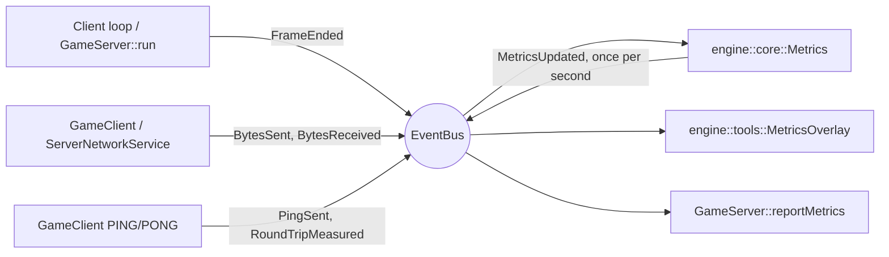

# Metrics

The engine measures frame timing, bandwidth, latency and packet loss. The
client shows them in an overlay toggled with **F3**; the server writes them to
its log. This page explains what each value means, how to read it, how the
pieces fit together, and how to add a metric.

---

## 1. What Is Measured

| Metric | Unit | Client | Server | Source |
| --- | --- | --- | --- | --- |
| Frames (ticks) per second | 1/s | yes | yes | `FrameEnded` |
| Average and worst frame time | ms | yes | no | `FrameEnded::seconds` |
| Average and worst work time | ms | yes | yes | `FrameEnded::busySeconds` |
| Upload and download | KiB/s | yes | yes | `BytesSent`, `BytesReceived` |
| Packets sent and received | 1/s | yes | yes | one event per datagram |
| Round-trip time (last and smoothed) | ms | yes | no | `RoundTripMeasured` |
| Jitter | ms | yes | no | `RoundTripMeasured` |
| Packet loss | % | yes | no | `PingSent`, `RoundTripMeasured` |

Every value except latency is computed over a **one-second window**
(`Metrics::WINDOW_SECONDS`). The window closes on the first frame that brings
its duration to one second or more, so rates are divided by the real elapsed
time, never by a rounded one.

- **Frame time** is the real time between two frames, before the gameplay
  clamp of 0.1 s. It shows the stalls the clamp would hide.
- **Work time** is the part of the frame spent working: update, drawing and
  audio on the client; network, simulation and broadcast on the server. On the
  client it stops before `endFrame()`, which waits for the 60 FPS limit. A
  client at 60 FPS with 2 ms of work has plenty of headroom; one at 60 FPS
  with 15 ms has almost none.
- **Bandwidth** counts whole datagrams, the 16-byte protocol header included,
  but not the UDP and IP headers (28 bytes more per datagram on IPv4).
- **Round-trip time** comes from `PING`/`PONG` (see [UDP protocol](RFC.md)).
  The client sends one probe every 250 ms. The smoothed value and the jitter
  use the TCP smoothing factors from RFC 6298 (1/8 and 1/4); jitter is the
  smoothed difference between two consecutive samples.
- **Packet loss** is the share of probes left unanswered over the last five
  windows (about 20 probes). An answer that arrives in the window after its
  probe still counts, so a short burst can read slightly low for a moment.

---

## 2. In the Game

### Client overlay

Press **F3** to show or hide the panel in the top-left corner:

```text
FPS     60.0   frame 16.7 ms (worst 18.2)
Work    2.10 ms (worst 4.05)
Ping    19 ms   avg 18   jitter 0.7
Loss    0.0 %
Up      5.23 KiB/s   33 pkt/s
Down    0.55 KiB/s   24 pkt/s
```

Values refresh once per second. `--` means there is nothing to measure yet:
latency and loss appear once the client is connected. The panel shows
"Collecting metrics..." during the first second.

The key is the `metrics` action in `settings.cfg` and accepts any supported key
name, for example `metrics = F1` (see [Run instructions](run_instructions.md)).
An existing `settings.cfg` without a `metrics` line keeps the F3 default.

The overlay uses `assets/fonts/LiberationMono-Regular.ttf` (SIL Open Font
License, see `assets/fonts/LiberationMono-LICENSE.txt`). The client refuses to
start if the font is missing, like the other required assets.

### Server log

While at least one datagram arrives per second, the server logs one window out
of ten (`GameServer::METRICS_REPORT_WINDOWS`), so about one line every ten
seconds. An idle server logs nothing.

```text
[INFO] Metrics: 60.0 ticks/s, tick work avg 0.14 ms / worst 0.30 ms (budget 16.67 ms), up 5.16 KiB/s (34 pkt/s), down 0.43 KiB/s (24 pkt/s)
```

The budget is the tick duration. A worst tick work time close to the budget
means the server is about to fall behind its 60 ticks per second.

### Reading the numbers

| Observation | Likely cause |
| --- | --- |
| FPS below 60 and work time near 16.7 ms | The client is CPU or GPU bound |
| FPS below 60 but low work time | The window is not focused or the OS throttles it |
| Worst frame far above average | Occasional stalls: asset loading, slow log output, OS scheduling |
| Ping around 17 ms on localhost | Normal: the server reads datagrams once per tick (up to 16.7 ms) |
| Loss above 0 % on localhost | Unexpected without `netem`: check the server log for timeouts or errors |
| Download grows with the number of entities | Expected: each snapshot sends 16 bytes per entity, 20 times per second |

On one connected client and an empty world, expect about 20 inputs and 4 pings
per second up (24 packets), and 20 snapshots, 4 pongs and the gameplay events
down.

---

## 3. How It Works

The producers and consumers only share the `EventBus`. The network code does
not know about the overlay, and the overlay does not know where the numbers
come from.



| Piece | Module | File |
| --- | --- | --- |
| Input events (`FrameEnded`, `BytesSent`, ...) | `engine::core` | `engine/core/include/engine/core/metrics/MetricsEvents.hpp` |
| `Metrics`, `MetricsSnapshot`, `MetricsUpdated` | `engine::core` | `engine/core/include/engine/core/metrics/Metrics.hpp` |
| `MetricsOverlay` | `engine::tools` | `engine/tools/include/engine/tools/MetricsOverlay.hpp` |
| `drawRect`, `drawText` | `engine::render` | `engine/render/include/engine/render/GraphicsBackend.hpp` |
| `PING`/`PONG` encoding and validation | R-Type | `games/rtype/src/utils/network/Protocol.cpp` |
| Probes, traffic events | R-Type client | `games/rtype/src/client/network/GameClient.cpp` |
| Frame events, F3 toggle, frame drawing | R-Type client | `games/rtype/src/client/app/ClientApp.cpp` |
| Pong replies, traffic events | R-Type server | `games/rtype/src/server/network/ServerNetworkService.cpp` |
| Tick events, log | R-Type server | `games/rtype/src/server/GameServer.cpp` |

`Metrics` lives in `engine::core` so the server, which does not link
`engine::render`, can use it. Only the overlay, which draws, lives in
`engine::tools`.

`Metrics` reads no clock: time only advances through `FrameEnded`. A window
therefore always matches real frames, and the collector can be tested by
publishing events by hand.

### Frame ownership

`RenderSystem::render()` only draws the world. The caller opens and presents
the frame, which lets it draw the overlay on top:

```cpp
window.beginFrame();
view.render(window, deltaTime);   // RenderSystem: background and sprites
overlay.draw(window);             // nothing if hidden
window.endFrame();
```

### Lifetimes

`Metrics` and `MetricsOverlay` keep a reference to the bus and hold
`Subscription`s, so the bus must be declared before them and outlive them. Both
are non-copyable because their handlers capture `this`.

---

## 4. Using It in Another Game

Nothing in the metrics code depends on R-Type, but the overlay key is **not**
automatic. The engine does not own the game loop: each game reads its own
input and opens and presents its own frames, so each game wires the key and
the drawing itself. R-Type does it in `ClientControls.cpp` (the F3 binding)
and `ClientApp.cpp` (the rest). The steps below are everything a new game
needs.

### Step 1: link the modules

```cmake
target_link_libraries(my_game PRIVATE engine::core engine::render engine::input engine::tools)
```

From the repository root, enable the module with `ENGINE_BUILD_TOOLS`, which
needs render and input. From an installed engine, request the `tools`
component in `find_package`.

### Step 2: ship a font

Copy a TTF font under the asset root (for example the one in `assets/fonts/`,
with its license file) and pass it to the window. Without a font, `drawText`
draws nothing and the overlay only shows its background.

```cpp
engine::render::SfmlRenderer window({.width = 1280, .height = 720, .title = "My Game", .fontFile = "fonts/LiberationMono-Regular.ttf"});
```

### Step 3: create the bus, the collector and the overlay

Declare the bus first: `Metrics` and `MetricsOverlay` subscribe to it and
must be destroyed before it.

```cpp
#include "engine/core/EventBus.hpp"
#include "engine/core/metrics/Metrics.hpp"
#include "engine/tools/MetricsOverlay.hpp"

engine::core::EventBus bus;
engine::core::Metrics metrics(bus);
engine::tools::MetricsOverlay overlay(bus);
```

### Step 4: bind a key

Pick an action name and give it a default key in the game's `InputMap`. Any
key name from the settings file works, including `F1` to `F12`.

```cpp
static constexpr std::string_view METRICS = "metrics";

engine::input::InputMap map;
map.bindKey(METRICS, "F3");
// map.loadFromMap(config) afterwards lets players rebind it with "metrics = F1"
engine::input::SfmlInput input(std::move(map));
```

### Step 5: the frame loop

Toggle on the key, draw the overlay after the scene and before `endFrame()`,
and publish the frame timing. Measure the work time before `endFrame()`,
which waits for the frame rate limit.

```cpp
using Clock = std::chrono::steady_clock;
auto lastFrame = Clock::now();

while (window.isOpen()) {
	const auto frameStart = Clock::now();
	window.handleEvent();
	input.update(window.hasFocus());
	if (input.justPressed(METRICS)) {
		overlay.toggle();
	}
	const float frameSeconds = std::chrono::duration<float>(frameStart - lastFrame).count();
	lastFrame = frameStart;

	// ... update the game ...

	window.beginFrame();
	// ... draw the game, for example RenderSystem::render ...
	overlay.draw(window);  // draws nothing while hidden
	const float workSeconds = std::chrono::duration<float>(Clock::now() - frameStart).count();
	window.endFrame();
	bus.publish(engine::core::FrameEnded{.seconds = frameSeconds, .busySeconds = workSeconds});
}
```

At this point the overlay shows FPS, frame time and work time. The network
lines read `0` and `--`.

### Step 6 (optional): network metrics

Publish one event per datagram where the game sends and receives them:

```cpp
transport.send(bytes);
bus.publish(engine::core::BytesSent{bytes.size()});

for (const auto& bytes : transport.receivePending()) {
	bus.publish(engine::core::BytesReceived{bytes.size()});
	// ... handle the packet ...
}
```

Latency and loss need a request the other side answers, like R-Type's
`PING`/`PONG` (see [UDP protocol](RFC.md) and `GameClient::sendPing` /
`GameClient::handlePong`): publish `PingSent` when a probe leaves and
`RoundTripMeasured` with the round trip in milliseconds when its answer
arrives.

### Checklist

| Symptom | Missing step |
| --- | --- |
| The key does nothing | Step 4 binding, or the `justPressed` test of step 5 |
| The panel shows no text | Step 2 font |
| The panel never appears, even after toggling | `overlay.draw` is not between `beginFrame` and `endFrame` |
| "Collecting metrics..." never goes away | `FrameEnded` is not published |
| Network lines stay at 0 | Step 6 |
| Crash on exit in a `Subscription` destructor | The bus is declared after `Metrics` or the overlay |

---

## 5. Measuring Under Bad Network Conditions

The subject asks to show bandwidth use and behaviour under latency. On Linux,
`tc netem` degrades the loopback interface, so a server and clients on the same
machine see a bad network:

```sh
sudo tc qdisc add dev lo root netem delay 50ms             # 50 ms each way
sudo tc qdisc change dev lo root netem delay 50ms 10ms     # with 10 ms of jitter
sudo tc qdisc change dev lo root netem delay 50ms loss 5%  # with 5 % loss
sudo tc qdisc del dev lo root                              # back to normal
```

`netem` on `lo` applies to both directions, so `delay 50ms` should show a ping
around 100 ms, plus up to 16.7 ms of server tick. Loss also applies twice: 5 %
each way loses about 10 % of the round trips. Comparing these expected values
with the overlay is a quick check that the measurements are right.

`netem` changes the whole loopback interface. Remove it when you are done, or
other local programs will stay slow.

---

## 6. Adding a Metric

Take "snapshot size" as an example.

1. **Event.** If no existing event carries the value, add a struct to
   `MetricsEvents.hpp`, for example `struct SnapshotSent { std::size_t bytes; };`.
2. **Producer.** Publish it where the value is known, here in
   `ServerNetworkService::broadcastSnapshot`. The producer only needs the bus.
3. **Collector.** In `Metrics`, add the window totals to `Window`, a
   `Subscription` member that updates them, and the computed value to
   `MetricsSnapshot` (filled in `closeWindow()`).
4. **Display.** Add a line in `MetricsOverlay::format()` and, for the server,
   in `GameServer::reportMetrics()`.
5. **Document** it in the table of section 1.

Not everything needs an event. A value that already exists at any moment, such
as the number of entities or connected clients, can be read directly once per
`MetricsUpdated` instead of being counted event by event. A per-system profiler
would also be too chatty for the bus; it belongs in a dedicated tool.

---

## 7. Limits

- Latency and loss are only measured by the client. The server answers probes
  but does not send any.
- The round trip includes the server's tick queueing (0 to 16.7 ms). Subtracting
  half a tick gives a better estimate of the pure network delay.
- Probes are never retransmitted, so a lost probe only lowers the loss estimate;
  it does not affect gameplay.
- A client talking to a server built before `PING` existed receives
  `ERROR UNKNOWN_TYPE` for each probe and logs a warning. Client and server must
  be updated together.
